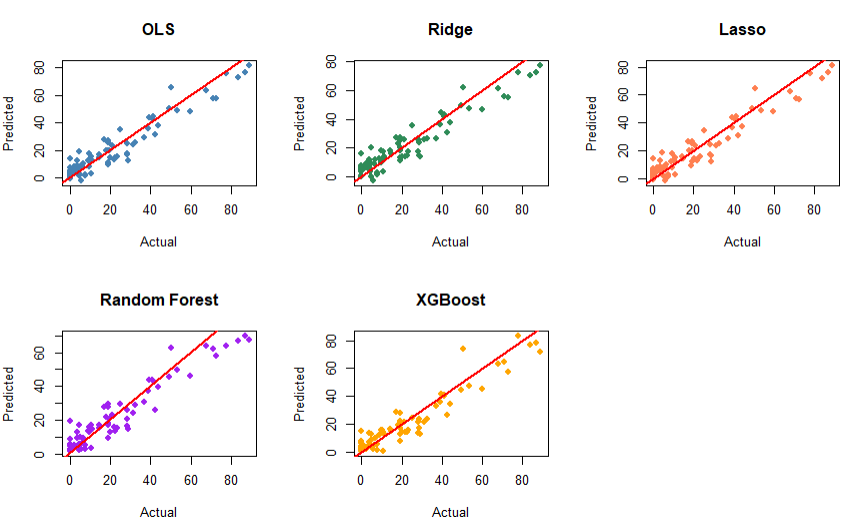
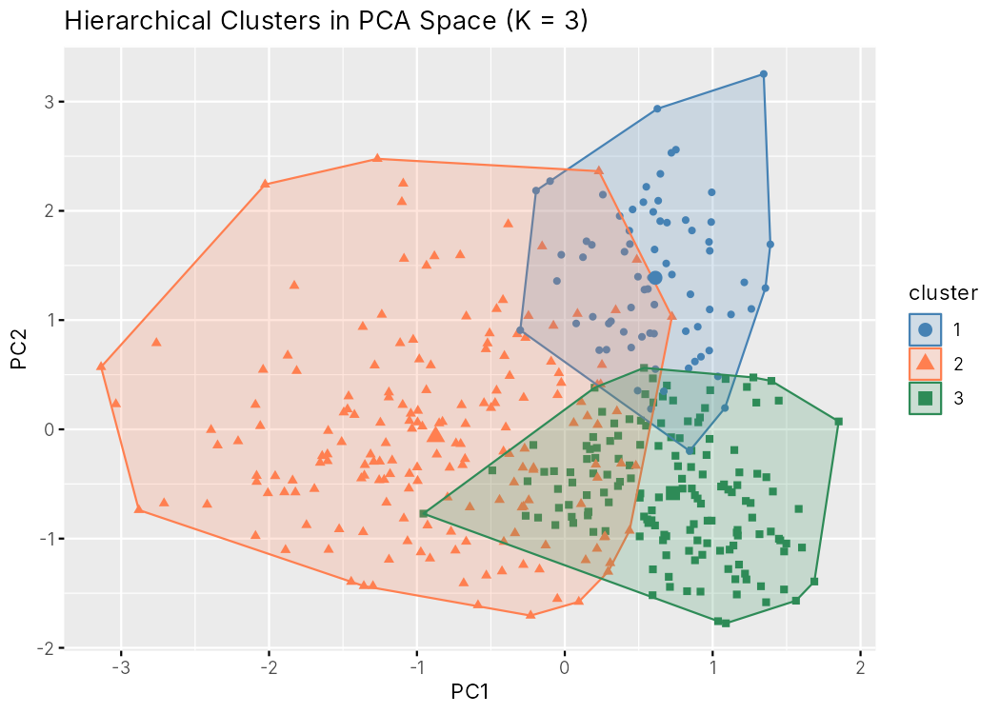
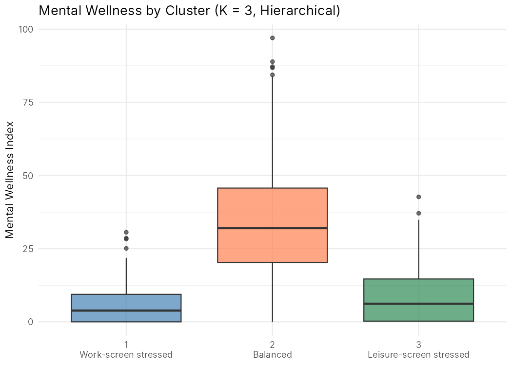

# Screen Time & Mental Wellness — Statistical Learning in R

What predicts mental wellness, and do people fall into distinct lifestyle profiles?
This project answers both questions on a survey of 400 adults, using **supervised regression**
(OLS, Ridge, Lasso, Random Forest, XGBoost) and **unsupervised learning** (PCA, hierarchical clustering, K-Means).

*Course project — Statistical Learning, MSc Data Science for Economics and Health, Università degli Studi di Milano (April 2026).*

📄 Full reports: [Supervised analysis (PDF)](reports/Supervised_Report.pdf) · [Unsupervised analysis (PDF)](reports/Unsupervised_Report.pdf)

---

## Key results

**1. Stress and sleep quality drive wellness; linear models predict it best.**

| Model | Test R² | Test RMSE | Test MAE | CV RMSE |
|---|---|---|---|---|
| OLS | 0.910 | 6.999 | 5.732 | 6.322 |
| Ridge | 0.895 | 7.532 | 6.224 | 6.461 |
| **Lasso (selected)** | **0.910** | **7.001** | **5.697** | **6.274** |
| Random Forest | 0.890 | 7.716 | 5.998 | 6.997 |
| XGBoost | 0.900 | 7.357 | 5.541 | 7.916 |

*Held-out test set of 79 participants; CV = 10-fold cross-validation repeated 3 times (XGBoost: 10-fold `xgb.cv`).*

- Each extra point of self-reported stress (0–10) is associated with **≈ 6.8 fewer wellness points**, holding other factors constant.
- Participants rating their sleep 1/5 score **≈ 11.8 points lower**, even at equal sleep hours and stress.
- Work and leisure screen time are negatively associated with wellness, but their effects are much smaller.
- Tree ensembles do not beat linear models: the signal is mostly linear.



**2. Three behavioural profiles emerge without using the wellness score.**

| | Work-screen stressed | Balanced | Leisure-screen stressed |
|---|---|---|---|
| Share of sample | 18% | 44% | 38% |
| Mean wellness (0–100) | 6.2 | 35.7 | 9.0 |
| Mean stress (0–10) | 9.6 | 6.7 | 9.2 |
| Work / leisure screen (h/day) | 5.2 / 5.8 | 1.7 / 5.8 | 1.3 / 8.5 |
| Remote workers | 99% | 35% | 11% |

- Two low-wellness groups have similarly high screen time but **different kinds** of screen use: work-driven (almost all remote workers) vs leisure-driven.
- Hierarchical clustering and K-Means agree on **84.5%** of assignments after label matching. Silhouette scores (0.29–0.34) show the groups overlap, so they describe tendencies rather than sharp boundaries.

<p float="left">
  
  
</p>

> All results are associations from cross-sectional, self-reported data, not causal effects.

---

## Methods at a glance

| Step | What was done |
|---|---|
| Data cleaning | Dropped `productivity` (r = 0.90 with the target, near-leakage) and `screen_time_hours` (= work + leisure); recoded the highly concentrated sleep-quality score into a binary *poor sleep* indicator |
| EDA | Distributions, correlation matrix, ANOVA / Tukey / Levene tests, residual-vs-fitted plots and Ramsey RESET test for non-linearity |
| Supervised | 80/20 split · 10×3 repeated CV with `caret` · λ tuned over a log grid for Ridge/Lasso · `tuneRF` + grid search for Random Forest (`ranger`) · `xgb.cv` for XGBoost rounds |
| Unsupervised | z-score scaling · PCA (3 components, 59.7% of variance) · Ward hierarchical clustering and K-Means · K chosen with silhouette, dendrogram and elbow · Hungarian label matching to compare methods · profiling on variables not used for clustering |

## Repository structure

```
├── R/
│   ├── 01_supervised.R      # EDA, preprocessing, 5 regression models, evaluation
│   └── 02_unsupervised.R    # PCA, hierarchical clustering, K-Means, profiling
├── data/                    # dataset + source information
├── reports/                 # full PDF reports
└── docs/img/                # figures used in this README
```

## How to run

Open `screen-time-mental-wellness.Rproj` (or set the working directory to the repository root), then:

```r
install.packages(c("tidyverse", "corrplot", "car", "lmtest", "caret", "glmnet",
                   "randomForest", "ranger", "xgboost", "effectsize", "e1071",
                   "gridExtra", "factoextra", "cluster", "clue"))

source("R/01_supervised.R")
source("R/02_unsupervised.R")
```

Both scripts use fixed seeds and reproduce the reported numbers when run top-to-bottom in a fresh R session. XGBoost results can differ slightly between `xgboost` package versions. Generated figures and result tables are written to `figures/`.

## Data

[Screen Time vs Mental Wellness Survey – 2025](https://www.kaggle.com/datasets/adharshinikumar/screentime-vs-mentalwellness-survey-2025) (Kaggle): 400 participants, 15 variables. See [`data/README.md`](data/README.md).

## Author

**Mohamed Amine Laabidi** — MSc Data Science for Economics and Health, University of Milan
